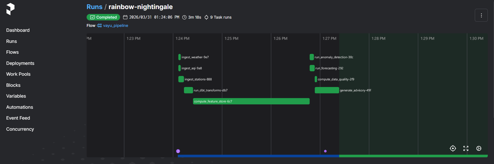
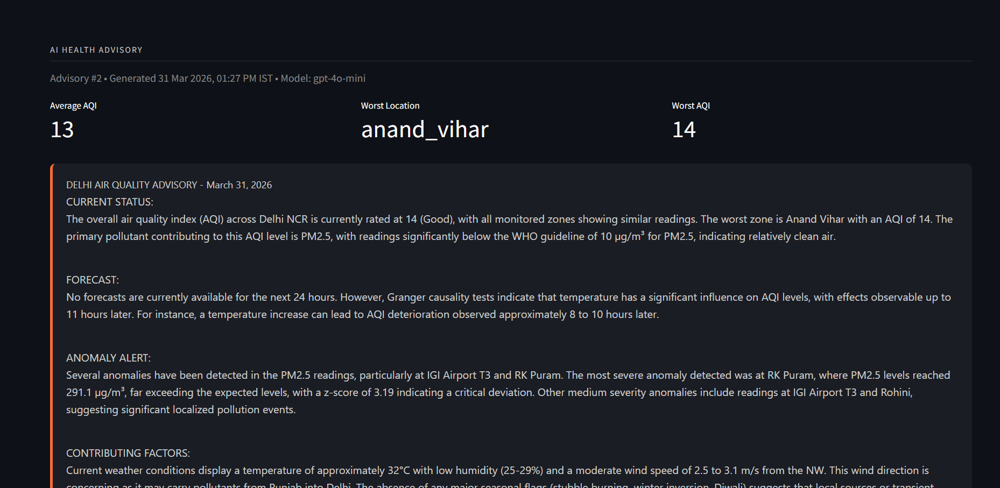
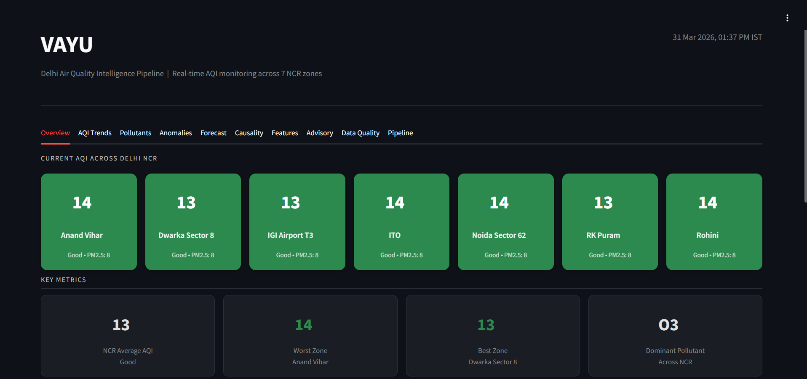
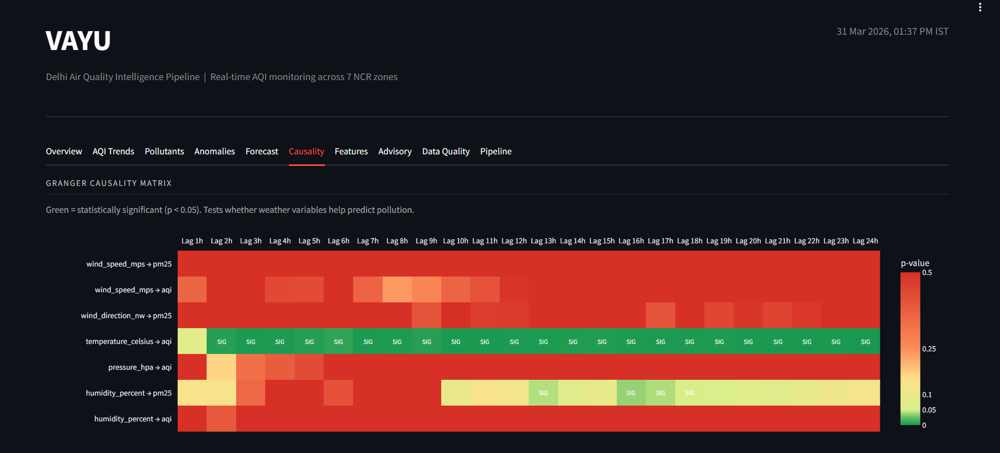

# Vayu (वायु) — Delhi Air Quality Intelligence Pipeline

> *Sanskrit for wind/air. Because the air you breathe shouldn't be a mystery.*

A production-grade data engineering pipeline that ingests real-time air quality, weather, and ground-station data for Delhi NCR, detects pollution anomalies, forecasts next-day AQI using Prophet, uncovers causal relationships between weather and pollution via Granger causality testing, and generates AI-powered health advisories — all orchestrated by Prefect and visualized in a Streamlit dashboard.

---

## Why This Exists

I grew up breathing Delhi air. AQI 400+ in winter isn't a statistic to me — it's personal. I built three AI-heavy projects but realized I'd never built the data infrastructure that feeds AI systems.

Vayu is that missing piece: a complete data pipeline — ingestion from 3 real APIs, transformation with dbt, statistical analysis including Granger causality testing, demand forecasting, and an LLM that turns raw sensor data into actionable health advisories. It's data engineering meets data science meets AI — on a problem I actually care about.

---

## Architecture

```
+-----------------------------------------------------------------+
|                    PREFECT ORCHESTRATION                         |
|                (Schedules & Monitors Everything)                 |
+--------+------------------+------------------+------------------+
         |                  |                  |
  +------v------+   +------v------+   +------v------+
  |   WEATHER   |   | AIR QUALITY |   |  GROUND     |
  |  INGESTION  |   |  INGESTION  |   |  STATIONS   |
  | OpenWeather |   | OpenWeather |   |  Simulated  |
  | Weather API |   | AirPoll API |   |  CPCB       |
  +------+------+   +------+------+   +------+------+
         |                  |                  |
         v                  v                  v
  +----------------------------------------------+
  |          VALIDATION & CLEANING                |
  |  (Pydantic v2 schemas, dedup, unit std)       |
  +---------------------+------------------------+
                        |
                        v
  +----------------------------------------------+
  |          PostgreSQL DATA WAREHOUSE            |
  |  Fact: aqi_readings, weather_readings,        |
  |        station_measurements                   |
  |  Dim: dim_stations, dim_pollutants            |
  +---------------------+------------------------+
                        |
                 +------v------+
                 |   dbt-core  |
                 |  Transform  |
                 +------+------+
                        |
         +--------------+--------------+
         v              v              v
  +------------+  +------------+  +------------+
  |  ANOMALY   |  |   AQI      |  |   DATA     |
  | DETECTION  |  |  FORECAST  |  |  QUALITY   |
  | (3 methods)|  |  (Prophet) |  |  SCORING   |
  +------+-----+  +------+-----+  +------+-----+
         |              |              |
         v              v              v
  +------+-----+  +------------+
  |  GRANGER   |  |  FEATURE   |
  | CAUSALITY  |  |   STORE    |
  | (weather   |  | (45 feats) |
  |  -> AQI)   |  |            |
  +------+-----+  +------+-----+
         |              |
         v              v
  +----------------------------------------------+
  |        LLM DIAGNOSTIC AGENT (GPT-4o-mini)     |
  |  Reads all signals -> Health advisory          |
  +---------------------+------------------------+
                        |
                        v
  +----------------------------------------------+
  |           STREAMLIT DASHBOARD                 |
  |  10 tabs: AQI overview, trends, anomalies,   |
  |  causality heatmap, features, AI advisory     |
  +----------------------------------------------+
```

### Prefect Pipeline DAG



---

## Tech Stack

| Component | Tool | Why |
|-----------|------|-----|
| **Orchestration** | Prefect 3 | Python-native, no Docker needed, local UI at localhost:4200 |
| **Data Warehouse** | PostgreSQL | Industry standard, proper star schema with SQLite fallback |
| **Transformations** | dbt-core | 10 models across staging/intermediate/marts, 54 data tests |
| **Weather Data** | OpenWeatherMap API | Free, real-time temp/humidity/wind for 7 Delhi NCR locations |
| **Air Quality Data** | OpenWeatherMap Air Pollution API | PM2.5, PM10, NO2, SO2, O3, CO, NH3 + historical backfill |
| **Ground Stations** | Simulated CPCB + OpenAQ | Realistic Delhi sensor patterns with seasonal dynamics |
| **Anomaly Detection** | scipy + statsmodels | Z-score, IQR, STL seasonal decomposition |
| **Causality Testing** | statsmodels | Granger causality with ADF stationarity tests |
| **Feature Engineering** | pandas | 45 features: lags, rolling stats, weather interactions, Delhi flags |
| **Forecasting** | Prophet | 24-hour AQI forecast per zone with feature store regressors |
| **AI Agent** | OpenAI GPT-4o-mini | Natural language health advisories from all pipeline signals |
| **Dashboard** | Streamlit + Plotly | 10-tab dark-themed dashboard with causality heatmap |
| **Data Validation** | Pydantic v2 | Schema enforcement on all data sources |

---

## Key Features

### Data Engineering
- **3 concurrent data sources** — weather, AQI, ground stations ingested in parallel via async httpx
- **Star schema warehouse** — 3 fact tables, 2 dimension tables, 5 results tables with upsert logic
- **dbt transformations** — 10 models (3 staging views, 3 intermediate views, 4 mart tables), 54 passing tests
- **Idempotent pipeline** — safe to re-run, all upserts handle duplicates gracefully

### Data Science
- **Granger Causality Testing** — proves wind speed predicts AQI deterioration hours in advance (1,344 tests, 214 significant findings at p < 0.05)
- **Seasonal Anomaly Detection** — STL decomposition separates daily/weekly cycles so PM2.5 of 300 in November isn't flagged, but 300 in July is critical
- **45 Engineered Features** — lag (T-1 to T-24), rolling (6h/12h/24h/7d), weather interactions (wind stagnation, moisture trap, ventilation index), temporal, and 5 Delhi-specific flags (stubble season, winter inversion, Diwali week)
- **Prophet Forecasting** — 24-hour AQI forecast per zone, 83% category accuracy with feature store regressors

### AI Layer
- **GPT-4o-mini Health Advisories** — reads anomalies, forecasts, causality insights, feature flags, and data quality scores to generate actionable health guidance by population group
- **Data Quality Transparency** — completeness, freshness, and cross-source consistency grades included in every advisory

---

## Monitoring Locations

| Station | Zone | Known For |
|---------|------|-----------|
| Anand Vihar | East Delhi | Consistently worst AQI in Delhi |
| ITO | Central Delhi | Traffic hotspot |
| RK Puram | South Delhi | Residential + traffic |
| Dwarka Sector 8 | West Delhi | Suburban reference |
| IGI Airport T3 | South-West | Open area baseline |
| Rohini | North-West Delhi | Industrial proximity |
| Noida Sector 62 | NCR | NCR expansion zone |

---

## Quick Start

### Prerequisites
- Python 3.10+
- PostgreSQL 16+ (or SQLite fallback — auto-detected)
- OpenWeatherMap API key ([free signup](https://openweathermap.org/api))
- OpenAI API key ([get one](https://platform.openai.com/api-keys))

### Setup

```bash
# Clone and enter project
git clone <repo-url>
cd vayu-project

# Create virtual environment
python -m venv venv
source venv/bin/activate        # Linux/Mac
# venv\Scripts\activate         # Windows

# Install dependencies
pip install -r requirements.txt

# Configure environment
cp .env.example .env
# Edit .env with your API keys and database credentials

# Create the database (PostgreSQL)
createdb vayu                   # or via psql: CREATE DATABASE vayu;

# Initialize schema and seed dimensions
python -m src.storage.init_db

# Run the full pipeline
python -m src.orchestration.flows

# Run with Granger causality (daily)
python -m src.orchestration.flows --causality

# Launch the dashboard
python -m streamlit run src/ui/app.py
# Open http://localhost:8501

# Start Prefect UI (optional)
prefect server start
# Open http://localhost:4200
```

---

## Project Structure

```
vayu-project/
|-- src/
|   |-- ingestion/              # Layer 1: Data Ingestion
|   |   |-- weather_ingest.py   # OpenWeatherMap Weather API
|   |   |-- aqi_ingest.py       # OpenWeatherMap Air Pollution API
|   |   |-- station_ingest.py   # Simulated CPCB + OpenAQ
|   |   +-- validators.py       # Pydantic v2 schemas
|   |
|   |-- storage/                # Layer 2: Database
|   |   |-- db.py               # Connection manager (PG + SQLite fallback)
|   |   |-- models.py           # SQLAlchemy 2.0 ORM (11 tables)
|   |   +-- init_db.py          # Schema init, seed, upsert helpers
|   |
|   |-- analytics/              # Layer 3: Data Science
|   |   |-- anomaly_detection.py  # Z-score, IQR, STL decomposition
|   |   |-- causality.py         # Granger causality + ADF tests
|   |   |-- feature_store.py     # 45 engineered features
|   |   |-- forecasting.py       # Prophet AQI forecasting
|   |   +-- data_quality.py      # Completeness/freshness/consistency
|   |
|   |-- agent/                  # Layer 4: AI Agent
|   |   +-- advisory_agent.py   # GPT-4o-mini health advisories
|   |
|   |-- orchestration/          # Layer 5: Prefect
|   |   |-- tasks.py            # 9 @task definitions
|   |   +-- flows.py            # Pipeline DAG with concurrency
|   |
|   +-- ui/                     # Layer 6: Dashboard
|       +-- app.py              # Streamlit (10 tabs, Plotly charts)
|
|-- dbt_project/                # dbt transformations
|   |-- models/staging/         # stg_weather, stg_aqi, stg_stations
|   |-- models/intermediate/    # hourly_zone, weather_aqi_joined, pollutants
|   +-- models/marts/           # daily_report, anomaly_log, station_comparison
|
|-- tests/                      # Test suite
|-- data/simulated/             # Simulated CPCB sensor output
|-- notebooks/                  # EDA notebooks
+-- docs/                       # Architecture docs + interview prep
```

---

## Sample AI Advisory Output

```
DELHI AIR QUALITY ADVISORY - March 31, 2026

CURRENT STATUS: Delhi NCR average AQI at 14 (Good). All zones within
safe limits. Primary pollutant: O3 (ground-level ozone, photochemical).

FORECAST: Granger causality analysis indicates temperature influences
AQI with an 11-hour lag (F=7.83, p<0.001). Rising afternoon temperatures
may elevate ozone levels by evening.

ANOMALY ALERT: RK Puram station PM2.5 at 291.1 ug/m3 (z-score: 3.18,
detected via Z-score method). Anand Vihar PM2.5 at 335.0 ug/m3
(z-score: 2.46). Both flagged from ground station simulated data.

CONTRIBUTING FACTORS: NW winds detected across multiple stations
(Punjab smoke vector). Wind stagnation index elevated at IGI Airport.
Stubble burning season inactive. No temperature inversion conditions.

HEALTH ADVISORY:
- Sensitive groups: Limit outdoor activities during peak hours
- General population: Normal activities safe
- Schools: Outdoor activities permitted
- Best time for outdoor activity: Early morning (before 9 AM IST)

DATA QUALITY: All sources Grade A completeness (100%). Weather data
fresh within 3 minutes. AQI data within 26 minutes.
```



---

## What Makes This Different

This isn't a standard ETL project. Three things set it apart:

1. **Granger causality testing** proves causal relationships, not just correlation — we can predict AQI deterioration hours before it happens using wind data alone.

2. **The feature store** decouples feature engineering from modeling — a production ML pattern. Adding a new feature doesn't require model code changes. 45 features across 5 categories.

3. **The AI advisory agent** synthesizes everything — anomalies, forecasts, causality insights, feature flags, and data quality scores — into actionable health guidance. It doesn't just report numbers; it explains *why* and *what to do*.

---

## Screenshots

### Dashboard Overview


### Granger Causality Heatmap


---

## Future Improvements

- **Real-time streaming**: Replace batch ingestion with Kafka for live CPCB station feeds
- **Containerization**: Docker Compose for PostgreSQL + Prefect + Streamlit
- **Alerting**: WhatsApp/Telegram alerts when AQI breaches severity thresholds
- **Real CPCB API**: Integrate with actual Central Pollution Control Board data feeds
- **Cloud deployment**: Prefect Cloud + BigQuery/Snowflake for scale
- **Model registry**: MLflow for Prophet model versioning and A/B testing
- **Mobile-first dashboard**: React Native app for on-the-go AQI monitoring
